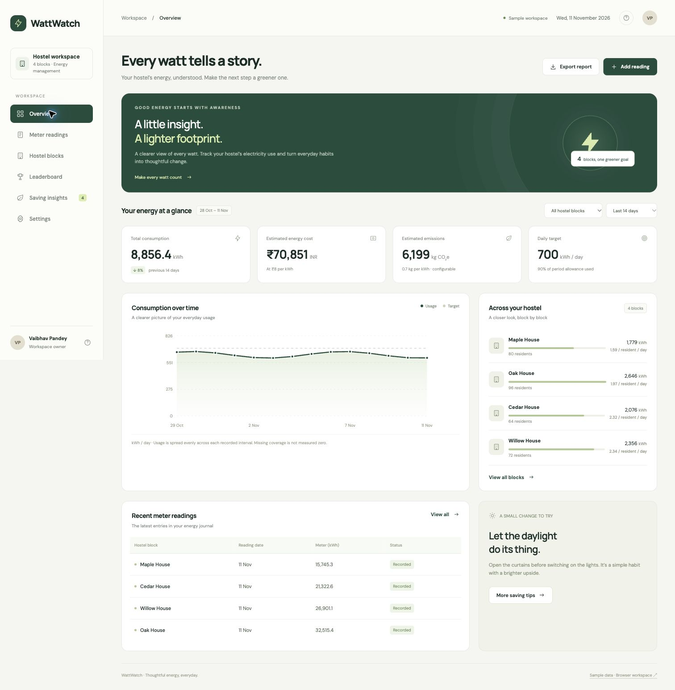

# WattWatch

**A clearer view of every watt.**

A working hostel electricity workspace for **Vaibhav Pandey**. Record cumulative meter readings, understand usage, compare blocks over matching periods and explore practical saving habits.

[Open the app](https://vaibhavcr09.github.io/wattwatch/)



## What works

- Responsive dashboard with an accessible mobile navigation menu.
- Add, edit and delete hostel blocks and dated cumulative kWh readings.
- Duplicate, future-date, negative-value, occupancy and backup validation.
- Usage trends, block and 7/14/28-day filters, register search and reset flags.
- Estimated energy cost and emissions with editable assumptions.
- A leaderboard normalised by residents and days, with matching-period eligibility.
- Saving-tip dialogs and an in-app explanation of the calculations.
- CSV report and reading exports, JSON backups, validated imports, sample and empty workspaces.
- Browser persistence across refreshes, with visible storage failures instead of silent data loss.

Every initial block, reading and resident count is fictional sample data. There is no live meter integration or claim of measured savings.

## Run locally

No JavaScript dependencies or build step are required. Use Python 3:

```sh
python3 -m http.server 5173 --bind 127.0.0.1
```

Open **http://127.0.0.1:5173**. Serve the folder over HTTP; opening `index.html` as a `file://` URL does not support ES module loading consistently. With Node 18+ installed, `npm start` runs the same command and `npm test` runs the domain tests.

## Try the complete workflow

1. Explore the four sample houses on Overview. Change the block and reporting period filters.
2. Open Hostel blocks → Add block. Enter a name and resident count.
3. Add a baseline reading on an earlier date, then a higher cumulative reading on a later date.
4. Check the register, the usage difference and the dashboard. A lower reading remains visible as a reset review flag.
5. Export a report or backup. Settings → Start empty workspace removes sample records after confirmation.

## Calculation rules

- **Interval kWh** = newer cumulative reading − previous cumulative reading for the same block, sorted by UTC calendar date. A single reading is a baseline.
- **Period totals** include only whole intervals with start and end inside the selected period. No partial-period extrapolation is applied. Missing data is not measured zero.
- **Decreasing readings** are flagged as possible meter resets. That interval is excluded from totals and ranks; later valid intervals still count. Correct a mistaken reading using Edit.
- **Chart** spreads each valid interval evenly over its days. It shows a recorded average, not a live or measured daily load. Missing coverage may leave gaps or partial aggregate coverage.
- **Cost** = recorded kWh × configured tariff. Fixed charges, taxes and tariff slabs are not included.
- **Emissions** = recorded kWh × configured factor. The default 0.7 kg CO₂e/kWh is illustrative, not an official local factor.
- **Leaderboard** = recorded kWh ÷ residents ÷ days. Boundary readings on both period dates and no decreasing interval are required. Lower is better. Equal periods and occupancy normalisation do not control for equipment or weather.
- **Daily target** is for the entire workspace; block targets are allocated by current resident count. Changes to a block's resident count recalculate historical per-resident results. Keep the count stable for a reporting period.
- A previous-period percentage appears only when selected blocks have complete boundary coverage in both periods.

## Data and privacy

The GitHub Pages app stores its workspace in browser `localStorage`, separately for each app. No private reports, social screenshots, credentials, analytics or student registration details are included. Records are not shared between devices. Browser storage can be cleared or blocked, so export backups when needed. Do not treat this demonstration as a utility bill or a calibrated measurement system.

Backups use a version 1 JSON schema: `blocks`, `readings`, `settings` and an optional `demo` marker. Import replaces the workspace only after validation and confirmation. Maximum supported size: 100 blocks, 20,000 readings and a 6 MB import file. CSV text is quoted and spreadsheet formula prefixes are neutralised.

## Local Flask + SQLite mode

WattWatch also includes a Python backend for the original Flask/SQLite concept:

```sh
python3 -m venv .venv
source .venv/bin/activate
pip install -r requirements.txt
python server.py
```

Open **http://127.0.0.1:5174**. The UI uses `/api/state` and persists to `workspace.sqlite3`, which is excluded from Git. The backend serves an allowlisted set of assets and validates every write. Static/browser and SQLite workspaces are separate; move records using JSON backups. To test the backend, run `python -m unittest -v test_server.py` inside the environment.

The Flask runner is a single-user local development server, with no sign-in or access control. It binds to loopback by default. It is not a public multi-user deployment. Simultaneous edits use last-write-wins. The initial backend sample snapshot has fixed dates; use Settings → Load sample data to refresh its dates.

## Tests

```sh
node --test core.test.js
```

Sixteen automated tests cover cumulative differences, costs/emissions, ordering, block isolation, period boundaries, baselines, duplicate dates, invalid/future dates, resets, normalised ranking, missing coverage, resident counts, settings, empty data, sample periods, CSV escaping and backup round trips.

Browser QA covers create/edit/delete workflows, search, filters, duplicates, resets, persistence, settings, exports/import, navigation, dialogs and mobile layout. See `QA.md` for the recorded checks.

## Publish with GitHub Pages

The repository root is deploy-ready. In **Settings → Pages**, select **Deploy from a branch**, choose **main** and **/ (root)**, then Save. No API keys, paid services or build pipeline are required. GitHub Pages runs the browser-storage version; Python does not execute there.

## Source map

| File | Purpose |
| --- | --- |
| `index.html`, `styles.css` | Accessible app shell and responsive visual design |
| `app.js` | Navigation, dialogs, forms, charts, storage and import/export |
| `core.js` | Validation, interval calculations, period summaries and ranking |
| `config.js` | App identity and storage namespace |
| `core.test.js` | Independent calculation and validation tests |

Fonts: DM Sans and Manrope from Google Fonts with system fallbacks. Icons and charts are inline SVG; no external chart library is needed.
